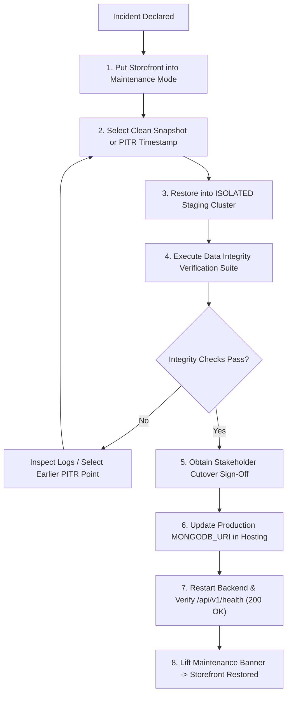

# LuxeCart Production Database Disaster Recovery Runbook

This document defines the operational procedures for backing up, verifying, and recovering the LuxeCart MongoDB database in production.

---

## 1. Architecture & Backup Strategy

### A. Managed MongoDB Service (MongoDB Atlas)
LuxeCart's production architecture targets a managed **MongoDB Atlas 3-node Replica Set (M10+ tier)** deployed in the primary Indian market cloud region (e.g., AWS `ap-south-1` Mumbai).

1. **Continuous Cloud Backups (Point-in-Time Recovery):**
   - **PITR Capability:** Enables cluster restoration to any second within a rolling 7-day window using continuous oplog capture.
   - **Availability:** Supported on Atlas dedicated tiers (M10 and above).
2. **Snapshot Retention Schedule:**
   - **Hourly Snapshots:** Retained for 24 hours.
   - **Daily Snapshots:** Retained for 30 days.
   - **Weekly Snapshots:** Retained for 12 weeks.
   - **Monthly Snapshots:** Retained for 12 months.
3. **Offsite & Air-Gapped Secondary Archive:**
   - Weekly automated encrypted export (`mongodump --archive --gzip`) transferred to an external, isolated storage bucket (e.g., AWS S3 with Object Lock or Cloudflare R2 WORM) in a secondary geographical zone.
   - Guards against catastrophic cloud provider outages, account compromises, or ransomware.

---

## 2. Recovery Objectives (Proposed Targets)

> [!IMPORTANT]
> The following recovery metrics represent **proposed operational targets** subject to business and infrastructure stakeholder approval. They are not contractual guarantees until formally signed off.

| Metric | Target | Rationale |
| :--- | :---: | :--- |
| **Recovery Point Objective (RPO)** | **$\le 5$ minutes** | Continuous oplog capture (PITR) minimizes transactional data loss during unexpected crashes or corruptions. |
| **Recovery Time Objective (RTO)** | **$\le 30$ minutes** | Standard timeframe to restore a snapshot to a new or existing Atlas cluster and update backend connection strings. |

---

## 3. Data Protection, Encryption & Compliance

LuxeCart handles Indian consumer orders, physical addresses, names, and phone numbers. Disaster recovery procedures must comply with the **Digital Personal Data Protection Act (DPDP Act 2023)** and best security practices:

1. **Encryption at Rest:**
   - All Atlas storage volumes and snapshot files are encrypted using AES-256 with cloud KMS keys.
   - Any offsite dump archives must be encrypted with client-side GPG prior to transmission.
2. **Encryption in Transit:**
   - All client-to-database connections enforce TLS 1.3 via `mongodb+srv://`.
3. **Access Control & Least Privilege:**
   - Only designated Lead DBAs and DevOps personnel hold permissions to trigger snapshot restorations.
   - Application connection strings (`MONGODB_URI`) are strictly granted `readWrite` on the `luxecart` database and cannot alter users or drop collections.
4. **Credential Redaction:**
   - Backup logs and scripts must never output raw database credentials. Use `[REDACTED_CREDENTIALS]` in all audit trails.

---

## 4. Emergency Recovery Procedure (Step-by-Step)

In the event of a catastrophic database failure, data corruption, or ransomware incident:



### Step 1: Quarantine & Maintenance Mode
1. Enable the storefront maintenance banner to prevent new customer orders or cart writes.
2. Halt background tasks and spreadsheet import jobs.

### Step 2: Restore to an Isolated Staging Environment FIRST
**NEVER restore directly into the live production cluster without prior verification.**
1. In the MongoDB Atlas Console, locate **Backup** $\to$ **Restore**.
2. Select either:
   - **Point in Time Restore:** Enter the timestamp immediately prior to the incident (e.g., `2026-10-13 10:14:00 UTC`).
   - **Snapshot Restore:** Select the most recent clean hourly/daily snapshot.
3. Select **Restore to a New Cluster** or **Restore to Staging Cluster** (`luxecart-staging-recovery`).

### Step 3: Data Integrity Verification Checklist
Connect to the recovered staging database and execute the verification suite:

```bash
# Set staging URI in test shell
node scripts/fast_launch_catalog_audit.js
node scripts/regression_phase6_1.js
```

Confirm the following benchmarks:
- [ ] **Collection Inventory:** All 13 collections exist (`users`, `products`, `orders`, `categories`, `coupons`, `addresses`, `reviews`, `carts`, `wishlists`, `returns`, `supporttickets`, `contents`, `importjobs`).
- [ ] **Document Counts:** Document totals closely match pre-incident metrics.
- [ ] **Unique Indexes:** Check that `variants.sku` sparse unique index, `users.email` unique index, and `orders.orderNumber` unique index are active.
- [ ] **Catalog Integrity:** Ensure primary product images, variant prices, and stock numbers match expected states.
- [ ] **Order Consistency:** Verify zero orders remain in an inconsistent partial state.

### Step 4: Stakeholder Sign-Off & Cutover
1. Present the verification summary to the Engineering Lead / Operations Lead.
2. Upon approval, update `MONGODB_URI` in the production backend hosting provider (e.g., Render, Railway, or VPS).
3. Restart the backend application servers.
4. Verify `GET /api/v1/health` returns `HTTP 200` with `status: "healthy"` and `database: "connected"`.
5. Remove the maintenance banner and resume normal customer traffic.

---

## 5. Local & CI/CD Backup Utility Reference

For developers and automated staging pipelines, LuxeCart includes `server/scripts/backup_database.js`:

```bash
# 1. Dry-run inspection (tests connection, lists collections, counts docs without writing)
node scripts/backup_database.js --dry-run

# 2. Perform a timestamped backup to server/backups/
node scripts/backup_database.js

# 3. Specify explicit custom output directory
node scripts/backup_database.js --out /secure/storage/backup_20261013
```

- Each backup produces compressed `<collection>.json.gz` files using Canonical BSON Extended JSON (`mongoose.mongo.BSON.EJSON`) and a `manifest.json` describing collection metadata, custom index definitions, and document counts.
- Refuses to overwrite existing backup directories.
- Credentials are automatically redacted in all console messages.

---

---

## 6. Local & Staging Restore Utility Reference (Phase 8.2.4 Hardened)

LuxeCart provides `server/scripts/restore_database.js` to restore backup snapshots into verified, isolated test or staging databases:

```bash
# Safely restore a backup directory into an authorized test or staging database
node scripts/restore_database.js \
  --source ./backups/db_backup_20261013_114215 \
  --target-db luxecart_staging_recovery \
  --target-env staging \
  --confirm-target \
  --drop \
  --confirm-drop \
  --allowed-hosts staging-cluster.mongodb.net,localhost
```

### A. Safeguards Enforced by Code (Phase 8.2.5 Hardened)
1. **Canonical Host Normalization Policy:**
   - Hostnames are converted to lowercase.
   - Trailing dots from DNS root FQDN representations (e.g., `cluster.mongodb.net.`) are stripped before matching.
   - Ports are validated within the positive integer range $1 \le \text{port} \le 65535$.
   - SRV URIs (`mongodb+srv://`) containing explicit ports are rejected.
   - Bracketed and unbracketed IPv6 addresses are parsed safely; all loopback representations (`::1`, `[::1]`, `0:0:0:0:0:0:0:1`) are canonicalized.
   - Multi-host replica sets are validated individually; empty host tokens (e.g., `host1,,host2`) are rejected.
2. **Multi-Factor Target Isolation:**
   - Validates database name, hostname, environment tag, and explicit confirmation simultaneously.
   - Database name containing `test`, `staging`, or `restore` is **not** treated as sufficient proof of isolation.
3. **Allowlist Bypass Resistance (Trust Boundary):**
   - An operator-configured allowlist (`--allowed-hosts` or `RESTORE_ALLOWED_HOSTS`) is an access control filter, **not proof that a target is non-production**.
   - Production keyword checks, known production host matches, superuser rejections, and environment validations execute before allowlist checks and **cannot be overridden** by allowlist entries.
4. **Production Configuration Integrity:**
   - Comparisons against production hosts use parsed, normalized host identities rather than raw substring matching.
   - Malformed production configurations (`PROD_MONGODB_URI` or `PRODUCTION_HOSTS`) fail closed immediately with `INVALID_PRODUCTION_CONFIG`, rather than silently swallowing errors.
5. **Decoded Credential Inspection & Superuser Enforcement:**
   - Decodes URL-encoded credentials (`decodeURIComponent`). Attempts to pass encoded superusers (e.g. `%61dmin`, `%72oot`, `%70rod_admin`) are caught and rejected (`UNAUTHORIZED_RESTORE_USER`).
6. **Dual-Confirmation for Destructive Operations:**
   - Passing `--drop` requires explicit companion flag `--confirm-drop`. Overwriting without explicit confirmation is rejected before any connection.
7. **Validation Before Network Connection:**
   - Target validation and backup archive integrity checks execute synchronously **before** attempting any MongoDB network connection.
8. **Credential Privacy:**
   - Redacts usernames and passwords from all console messages, manifest paths, and error stacks (`[REDACTED_CREDENTIALS]`). All authority forms (including passwords containing `@` or colons) are scrubbed.

### B. Safeguards Requiring Infrastructure & Operator Configuration
1. **Dedicated Database Users:**
   - Operators must provision dedicated database users for staging/test restores. The user should possess only `readWrite` on the designated test database (`luxecart_test`), with zero cluster-wide privileges (`clusterAdmin`, `root`, or `dbAdminAnyDatabase`).
2. **Cluster & VPC Network Separation:**
   - Staging/restore clusters must reside in separate network VPCs or projects from the live production cluster, with dedicated IP access lists.
3. **Credential Segregation:**
   - Production connection strings (`MONGODB_URI`) must never be placed in staging or developer environment `.env` files.
4. **Environment Variable Configuration:**
   - Operators should define `RESTORE_ALLOWED_HOSTS` and `PRODUCTION_HOSTS` in CI/CD pipeline profiles to govern permissible restore targets.

---

## 7. Backup Format & Consistency Analysis

| Attribute | Managed Atlas Snapshot / `mongodump --oplog` | Mongoose EJSON Fallback (`backup_database.js`) |
| :--- | :--- | :--- |
| **Point-in-Time Consistency** | **Atomic / Consistent Across Collections:** Captured at an exact point in time via oplog replay or underlying storage volume snapshot. | **Sequential Collection Iteration:** Exports collections sequentially. In active production, concurrent writes could introduce minor cross-collection timestamp skew. |
| **BSON Type Preservation** | **Full Native BSON Fidelity:** Preserves all 32-bit/64-bit ints, Decimals, Dates, and ObjectIds. | **Full Extended JSON Fidelity:** Preserves ObjectIds and Dates via Canonical BSON EJSON (`$oid`, `$date`). |
| **Index Reconstruction** | Rebuilds all index specifications automatically. | Rebuilds all custom index specifications defined in the manifest. |
| **Recommended Operational Use** | **Primary Production Disaster Recovery** (Atlas Automated Snapshots & PITR). | **Secondary Staging/CI Fixtures, Offline Audits, & Portable Backups**. |

